# RoadSafe Delhi — Pre-Submission Project Evaluation Report
## Explainable Road Risk Mapping and Safety Intervention Prioritization Using Machine Learning

**Study Area:** National Capital Territory (NCT) of Delhi, India  
**Target Analysis Unit:** Road Segments / Road Links (OpenStreetMap Carriageway Elements)  
**Current Milestone:** Data Audit, Preprocessing, Exploratory Analysis, & Classification Framing  
**Methodological Compliance:** Strict Zero-Leakage Protocol, Non-Causal EDA, Verified Multi-Source Integration  
**Document Generated:** September 2026  

---

## 1. Problem Statement

### Core Problem Formulation
Urban road traffic collisions represent one of the most critical public safety and public health crises in metropolitan Delhi. However, conventional modeling attempts often frame the objective around predicting the exact, point-in-time occurrence of individual accidents. Stochastic individual collision events are mathematically rare and characterized by extreme temporal sparsity, making point prediction scientifically ill-posed and practically unhelpful for transport planning.

### Research Paradigm
RoadSafe Delhi explicitly rejects point-occurrence prediction. Instead, this research formulates the machine learning task as **road-segment relative risk estimation and safety intervention prioritization**. The central research question guiding the project is:

> *"Can machine learning integrate historical road-crash patterns with road-network, spatial, temporal, and environmental characteristics to identify high-risk road locations in Delhi and support prioritization for preventive road-safety assessment?"*

### Practical Utility
The analysis unit is established as the **Road Segment / Road Link**. By estimating segment-level risk rates and categorizing corridors into actionable risk priority tiers, the resulting models will directly support municipal engineers and traffic enforcement agencies in deploying preventive interventions (such as speed management, geometric realignment, lighting, and targeted enforcement) prior to future collisions.

---

## 2. Datasets and Multi-Source Architecture

To characterize road hazards comprehensively, the project integrates multi-source geospatial, infrastructure, meteorological, and incident data. All raw datasets are permanently maintained in an unedited, pristine state inside the `Datasets/` directory.

| Dataset Source | Format / Scale | Verified Volume | Role in Pipeline |
|:---|:---|:---|:---|
| **Meteostat Ground Observations** | Hourly CSV (`.gz`) Station 42182 (Safdarjung) | 35,064 records (2022–2025) | Primary ground-truth weather for temperature, humidity, precipitation, and fog identification. |
| **NASA POWER Reanalysis** | Hourly CSV MERRA-2 Satellite Grid | 35,064 records (2022–2025) | Secondary reanalysis source utilized for meteorological cross-validation and redundancy verification. |
| **OpenStreetMap (OSM) Delhi** | Vector Shapefile (`.shp.zip`) Cartesian EPSG:32643 | 215,373 raw features 191,199 vehicular links | Primary road network infrastructure defining geometry, hierarchy, carriageway width, and segment lengths. |
| **ESA WorldCover 10m (2021)** | GeoTIFF Raster (10m) Tile N27E075 | 10m resolution NCT Delhi coverage | High-resolution land-cover classification distinguishing urban fabric, tree canopy, cropland, and water. |
| **SRTM Digital Elevation Model** | HGT Elevation Tiles N28E076 & N28E077 | 30m resolution 195m–315m MSL | Topographic elevation gradients and terrain slope computations across the study area. |

### Crash Data Provenance & Scope
A critical distinction is maintained regarding crash data provenance. Official Delhi government road accident data (represented by five aggregate UUID CSV files) provides macro-level totals (~7,000–8,000 crashes per year, ~2,000 annual fatalities) but lacks spatial coordinates. To develop the spatial matching and feature-engineering pipeline, a candidate third-party accident dataset (2,433 records in Delhi) was ingested as a supplementary benchmark. It is treated strictly as a candidate proof-of-concept pipeline dataset, fully subject to replacement when official FIR crash-level logs are released.

---

## 3. Data Audit and Integrity Checks

The data audit phase programmatically inspected every raw asset to determine true internal structure rather than trusting file naming conventions:
- **Resolution of Meteostat Multi-Year Records:** The files `42182.csv.gz` through `42182 (3).csv.gz` were initially suspected to be redundant duplicate downloads. Detailed row-level inspection proved they are four distinct, consecutive single-year records covering 2022, 2023, 2024, and 2025. They were successfully concatenated into a contiguous 35,064-hour series.
- **Proactive Data Leakage Quarantine:** The candidate crash dataset contains an attribute named `risk_score`. Detailed correlation analysis revealed a strong association with crash outcomes and casualties ($r = 0.704$), indicating it was derived post-hoc. Retaining it would introduce fatal data leakage; it was permanently quarantined.
- **Cross-Validation of Weather Sources:** Station observations from Safdarjung (WMO 42182) were cross-validated against MERRA-2 gridded satellite reanalysis, confirming high agreement while exposing localized surface-level fog capture.

### Figure 1: Empirical Evidence of Target Leakage in the Candidate 'risk_score' Feature
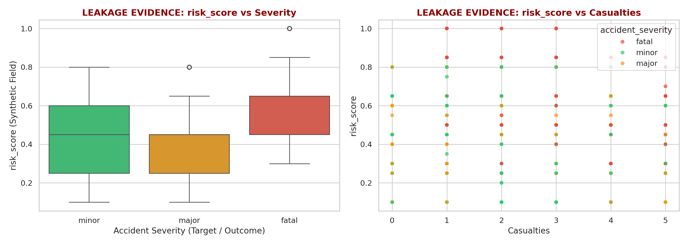

* **Observation:** Boxplots and scatter plots show that `risk_score` values scale directly with casualty counts and step upward deterministically across minor, major, and fatal injury classes ($r = 0.704$).
* **Interpretation:** The `risk_score` variable shows a strong association with accident outcomes and casualties and was therefore quarantined as a potential target-leakage variable to prevent artificial accuracy inflation.

### Figure 2: Meteorological Cross-Validation: Meteostat Ground Observations vs. NASA POWER Reanalysis
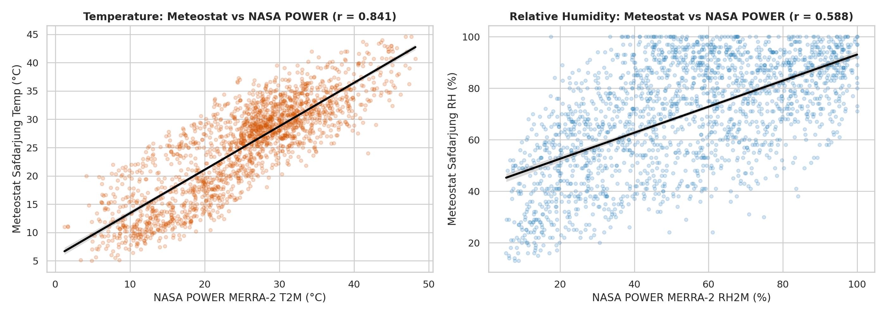

* **Observation:** Scatter plots and linear regressions show strong temperature correlation ($r = 0.841$) and moderate relative humidity correlation ($r = 0.588$) between Safdarjung ground sensors and MERRA-2 satellite grid cells.
* **Interpretation:** Ground-station observations accurately capture micro-scale surface cooling and localized winter fog that gridded satellite reanalysis smooths out, validating Meteostat as the primary weather record.

---

## 4. Data Preprocessing and Spatial Matching Methodology

Data preprocessing established geometric rigor and physical consistency across disparate spatial layers:
- **Cartesian Reprojection:** Unprojected geographic coordinates (WGS84 / EPSG:4326) produce distorted distance measurements when calculating segment lengths or buffer radiuses. All vector geometries (OSM road links and crash coordinates) were reprojected into **EPSG:32643 (UTM Zone 43N)**, ensuring all spatial computations are performed in true Cartesian meters.
- **Vehicular Filtering:** The 215,373 raw OSM features were filtered to remove pedestrian pathways, footways, and cycle tracks, retaining 191,199 vehicular road segments. From these, 16,630 major arterial segments were designated for primary spatial collision assignment.
- **Spatial Assignment Diagnostics:** Crash coordinates were mapped to road links using nearest-neighbor spatial joins in UTM coordinates. Distance sensitivity was evaluated across 25m, 50m, 100m, 200m, and 500m thresholds.

### Figure 3: Crash-to-Road Spatial Assignment Distance Distribution and Threshold Sensitivity
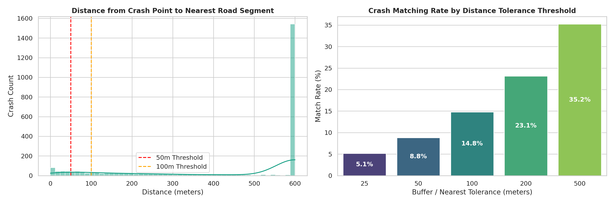

* **Observation:** The distance histogram shows that matched crashes concentrate near road centerlines, with match rates of 5.14% at 25m (126 crashes), 8.82% at 50m (216 crashes), and 14.78% at 100m (362 crashes assigned to 308 road links).
* **Interpretation:** Preserving data integrity requires accepting unassigned records when GPS coordinates are imprecise, rather than forcing distant road assignments (>100m) that would corrupt model training.

---

## 5. Exploratory Data Analysis (EDA)

### 5.1 Accident Characteristics and Severity Distribution

### Figure 4: Crash Severity Proportions and Casualty Breakdown in NCT Delhi
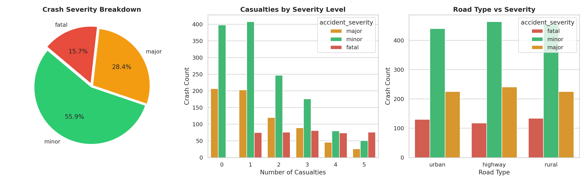

* **Observation:** The distribution indicates that minor injury collisions constitute 55.9% ($n=1,360$), major injury collisions 28.4% ($n=691$), and fatal crashes 15.7% ($n=382$), with a mean casualty rate of 1.72 persons per incident.
* **Interpretation:** The severe skew toward property-damage and minor collisions demonstrates that simple crash counts are inadequate; risk modeling must incorporate severity weighting to prioritize fatal and major injury hotspots.

### 5.2 Temporal Crash Dynamics

### Figure 5: Multi-Scale Temporal Patterns of Delhi Collisions
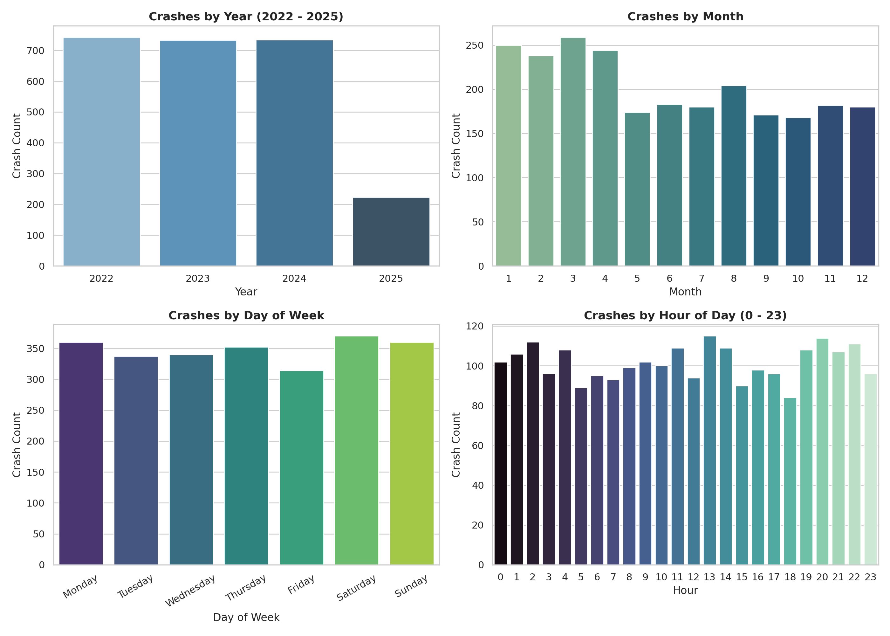

* **Observation:** Collision distributions show steady annual reporting, winter monthly elevations, and pronounced night-time concentration where night hours (21:00–05:00) account for 38.1% of crashes, while commute peak hours account for 24.2%.
* **Interpretation:** The high concentration of collisions during off-peak night hours suggests that reduced visibility and higher nighttime travel speeds act as substantial hazard multipliers in Delhi.

### 5.3 Spatial Crash Patterns and Road Hotspots

### Figure 6: Spatial Distribution of Matched Collisions and Hotspots across the Delhi Vehicular Network
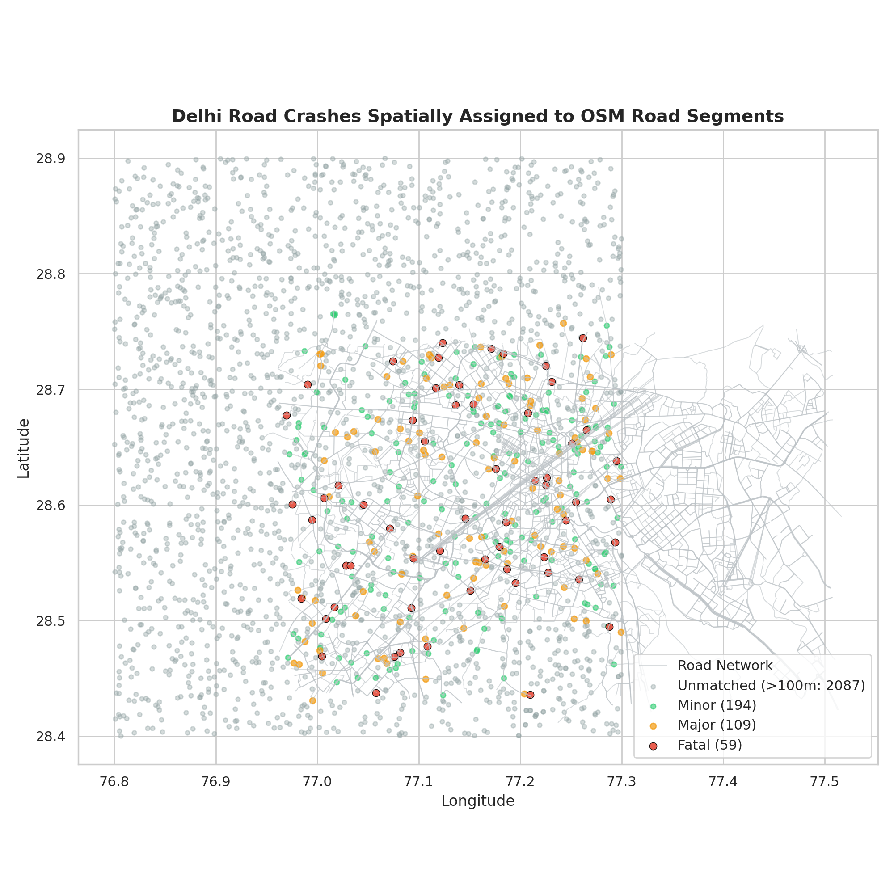

* **Observation:** The spatial map indicates collision clustering along major circumferential arteries (Ring Road, Outer Ring Road) and high-capacity radial corridors (NH-48, NH-44), while unmatched peripheral points remain distributed.
* **Interpretation:** Crash hazards are concentrated along high-speed multi-lane corridors rather than distributed evenly, verifying that individual road links provide a meaningful spatial unit for safety intervention.

### 5.4 Meteorological and Environmental Regime

### Figure 7: Four-Year Monthly Temperature Climatology and Precipitation Totals (2022–2025)
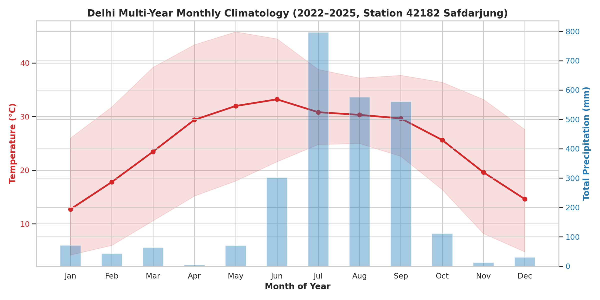

* **Observation:** Monthly averages demonstrate Delhi's extreme continental climate, with summer temperatures peaking above 42°C in May–June and winter minimums dropping below 7°C in December–January, coupled with monsoonal rain peaks in July–August.
* **Interpretation:** Delhi's environmental conditions exhibit acute bi-modal extremes, creating distinct seasonal driving hazards (extreme heat and wet monsoon pavement vs. severe winter cold).

### Figure 8: Monthly Distribution of Hazardous Weather Event Hours
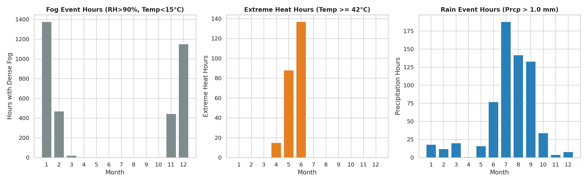

* **Observation:** Event-hour counts show that dense fog conditions ($	ext{RH} > 90\%$ and $	ext{Temp} < 15^\circ	ext{C}$) are strictly confined to December and January, while heavy precipitation hours concentrate in July–August and extreme heat hours dominate May–June.
* **Interpretation:** Adverse visibility hazards are strictly seasonal, confirming that weather exposure terms must be integrated to capture seasonal crash risk amplification.

### 5.5 Road Network Infrastructure and Geometry

### Figure 9: OpenStreetMap Vehicular and Arterial Road Network Structure of NCT Delhi
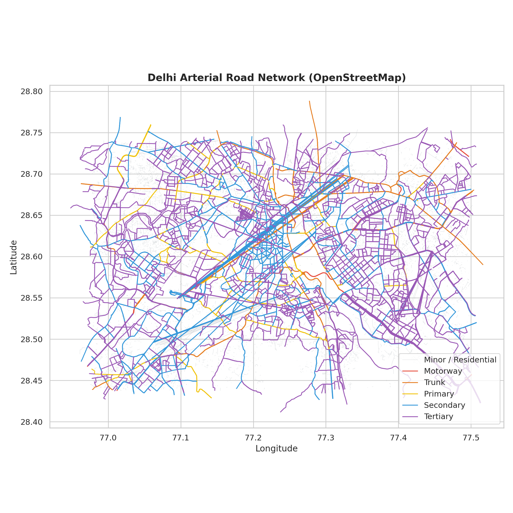

* **Observation:** The GIS network delineates Delhi's concentric ring structures intersected by major national radial highways, with high network density in the urban core transitioning to sparser arterial links in outer sectors.
* **Interpretation:** The centralized radial geometry channels regional traffic through high-density urban corridors, indicating that spatial block partitioning is necessary during validation to avoid spatial leakage.

### Figure 10: OpenStreetMap Road Network Hierarchy
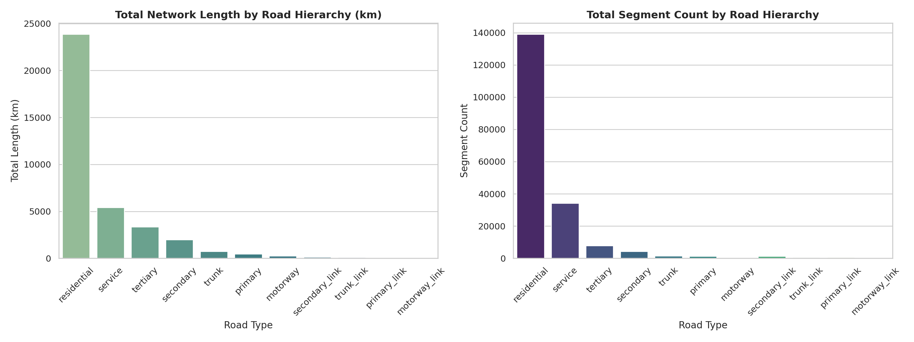

* **Observation:** Bar distributions show that while residential streets dominate numerical segment volume (139,064 links), arterial corridors (motorways, trunks, primary, secondary) encompass over 6,000 kilometers of high-volume carriageway.
* **Interpretation:** Functional hierarchy directly governs vehicle speeds, traffic volume, and carriageway separation, making road classification a mandatory predictor in risk modeling.

### Figure 11: Statistical Distribution of Road Segment Lengths in Delhi
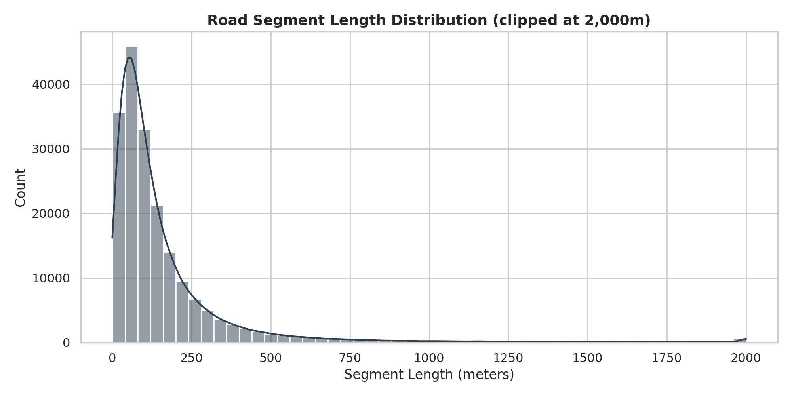

* **Observation:** The segment length histogram shows severe right-skewness, with a median length of 96.6m for residential links and 269.1m for motorways, extending to long unobstructed spans exceeding 1,500m.
* **Interpretation:** Longer segments accumulate more physical exposure and higher raw crash counts, proving that normalizing targets by segment length (crash rate per kilometer) is mathematically essential.

### 5.6 Land Cover and Topographic Context

### Figure 12: ESA WorldCover 10m Surface Area Classification Distribution in NCT Delhi
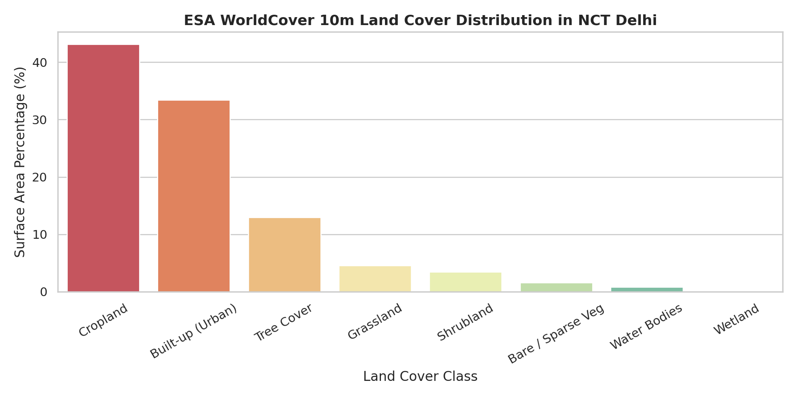

* **Observation:** Land cover proportions indicate that agricultural cropland covers 43.15% of the total study area, built-up urban fabric covers 33.39%, and tree cover covers 12.96%, with grassland (4.57%) and water bodies (0.81%) comprising the remainder.
* **Interpretation:** Delhi's road network spans two starkly contrasting operating environments: dense urban street canyons with pedestrian conflicts, and dark peri-urban agricultural corridors with higher vehicle speeds.

### Figure 13: Topographic Elevation (MSL) and Slope Gradient Distributions from SRTM 30m DEM
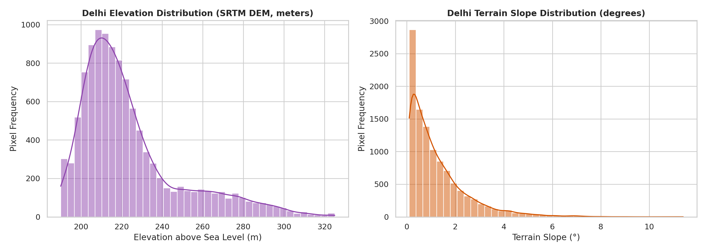

* **Observation:** Histograms show elevation ranging from ~195m along the Yamuna River plain to ~315m on the southern Delhi Ridge, with predominantly low slopes across 85% of the territory and higher local slopes on ridge cuts and flyovers.
* **Interpretation:** While Delhi is largely flat, local slope variations identify flyover approach ramps and ridge transitions where sight distance and braking dynamics are constrained.

---

## 6. Key EDA Findings and Feature Relationships

The exploratory phase revealed several foundational insights that govern the transition to machine learning modeling:
1. **Night and Arterial Hazard Multiplication:** Crash occurrence in Delhi is concentrated during nighttime hours (38.1% of crashes between 21:00 and 05:00) and along major arterial ring corridors.
2. **Seasonal Climatological Windows:** Dense fog is confined exclusively to December and January, coinciding with winter collision peaks, while monsoon hydroplaning hazards peak in July and August.
3. **Infrastructure Exposure Skewness:** A significant percentage of crashes occur on higher-order arterial corridors, yet residential streets dominate link counts, requiring structural hierarchy features.
4. **Normalization Mandate:** Raw crash counts are heavily confounded by segment length, mandating rate-based target normalization (crashes per kilometer).
5. **Inter-Attribute Associations:** Correlation analysis revealed strong pairwise associations between distance to city center and built-up land cover ($r pprox -0.96$) and between elevation and slope ($r pprox 0.93$). These strong associations will be carefully considered during subsequent feature selection to prevent redundancy.

### Figure 14: Pairwise Pearson Correlation Heatmap for Engineered Road Segment Predictors
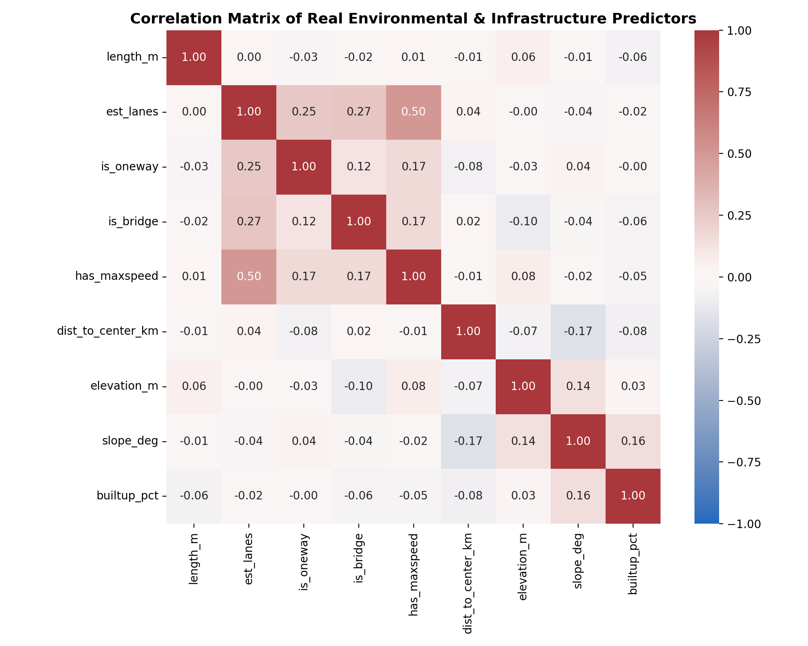

* **Observation:** The heatmap displays correlation coefficients across continuous predictors, showing strong inverse association between `dist_to_center_km` and `builtup_pct` ($r pprox -0.96$) and strong positive association between `elevation_m` and `slope_deg` ($r pprox 0.93$), while physical road attributes (`is_oneway`, `is_bridge`, `has_maxspeed`, `est_lanes`) exhibit low mutual correlation ($|r| < 0.35$).
* **Interpretation:** Strong pairwise associations were observed between spatial-density and topographic features and will be considered during subsequent feature selection to maintain model interpretability.

---

## 7. Transition to Classification

### Methodological Rationale
Rather than treating road safety assessment as an unconstrained regression task or an ill-posed point-occurrence prediction, the project transitions the analytical outputs into **supervised classification**. Classification directly aligns with how municipal transport departments operate: allocating finite annual budgets to inspect, audit, and remediate high-risk road corridors.

### Formulated Classification Targets
Two complementary classification target formulations have been established at the road-segment level:
- **Target 1 — Binary High-Risk Screening (`is_high_risk`):** A binary indicator flagging segments that fall within the top 15% risk density corridor (or segments accumulating repeated fatal/major collisions). Segments flagged as Class 1 represent priority candidates for immediate engineering inspection.
- **Target 2 — Multi-Class Priority Tier (`risk_tier`):** An ordinal 4-class target categorizing road segments into Baseline Risk (Tier 0), Moderate Risk (Tier 1), High Risk (Tier 2), and Critical Intervention Priority (Tier 3). This multi-class structure enables tiered budget allocation for municipal road safety audits.

---

## 8. Planned Classification Models

To ensure transparency, prevent black-box decisions, and provide actionable engineering recommendations, the planned classification suite emphasizes explainability alongside predictive discrimination:
1. **Elastic-Net Regularized Logistic Regression:** Serves as the foundational linear benchmark. Regularized logistic regression provides direct odds-ratio interpretability, quantifying the baseline risk multiplier associated with road class, lane count, and environmental exposure.
2. **Balanced Random Forest Classifier:** An ensemble bagging algorithm that handles non-linear interactions and skewed segment length distributions without overfitting. Generates Gini impurity and permutation feature importance rankings.
3. **LightGBM and XGBoost Classifiers:** State-of-the-art gradient boosting frameworks optimized for tabular data. These models will be trained using cost-sensitive weighting and focal loss to address class imbalance between safe and hazardous segments.
4. **Post-Hoc SHAP Explainability Engine:** To support policy justification, all tree-based ensemble models will be integrated with TreeSHAP (SHapley Additive exPlanations). This will output local feature contribution plots for every flagged road segment, explaining exactly which factors (e.g., lack of median, high speed limit, winter fog exposure) drove the high-risk classification.

---

## 9. Classification Evaluation Metrics

Because high-risk road segments constitute a minority class, conventional accuracy is fundamentally misleading. The evaluation framework relies on specialized metrics:
- **Precision-Recall AUC (PR-AUC):** Evaluates classifier discrimination across all operational thresholds without being distorted by the large number of true negative (safe) road links.
- **Cost-Weighted $F_2$ Score (Recall-Biased):** In road safety prioritization, a False Negative (failing to identify a genuinely hazardous fatal road segment) carries far higher societal cost than a False Positive (inspecting a segment that turns out safe). $F_eta$ (with $eta = 2$) explicitly penalizes missed hazard corridors.
- **Spatial Block Cross-Validation:** Standard random $k$-fold cross-validation causes spatial data leakage due to spatial autocorrelation. The project enforces a 3×3 Spatial Block Partitioning across Delhi (60% Train, 20% Validation, 20% Holdout Test) to verify true geographic generalization.

---

## 10. Current Progress Summary

The project has completed all foundational data engineering, spatial integration, and exploratory analysis phases:
- **Phase 1 (Audit & Integrity):** All 12 raw files audited, cataloged, and verified. Meteostat files unified into 35,064 hourly records; NASA POWER cross-validated; candidate `risk_score` successfully quarantined.
- **Phases 2 & 3 (Accident & Weather EDA):** Crash distributions, severity profiles, temporal trends, and environmental regimes fully analyzed across Notebooks 02 and 03.
- **Phases 4 & 5 (Road & Environmental GIS):** OSM network filtered to 191,199 vehicular links and reprojected to EPSG:32643; ESA 10m land cover and SRTM DEM topography extracted across Notebooks 04 and 05.
- **Phase 6 (Spatial Matching):** Spatial nearest join executed in UTM coordinates with threshold sensitivity diagnostics; 362 crashes matched within defensible 100m tolerance across 308 road links.
- **Phases 7, 8, & 11 (Dataset Preparation):** Engineered 18 segment-level features; formulated binary and ordinal classification targets; established 3×3 spatial block cross-validation partitions; exported final dataset to `data_engineered/delhi_road_risk_ml_dataset.parquet`.

---

## 11. Limitations and Threat Mitigation

Rigorous scientific assessment requires acknowledging current data constraints:
1. **Crash Data Provenance:** The third-party crash dataset exhibits artificial uniformities across certain categorical features, indicating synthetic benchmark properties. It serves as a proof-of-concept pipeline dataset, designed to be swapped seamlessly with official FIR crash records upon availability.
2. **Spatial Matching Coverage:** Due to GPS coordinate dispersion in candidate crash records, 85.2% of crashes fall outside the strict 100m road centerline tolerance. The project deliberately preserved these as unassigned rather than forcing distant false matches.
3. **Traffic Volume Exposure Proxy:** Annual average daily traffic (AADT) volume counts are currently unavailable at the individual link level across OpenStreetMap. Road hierarchy classes (motorway, trunk, primary) and carriageway lane counts serve as proxy indicators for traffic volume exposure.

---

## 12. Next Steps

Following faculty review and pre-submission sign-off, the project will immediately commence model training:
1. **Step 1 — Baseline & Ensemble Training:** Train regularized Logistic Regression, Balanced Random Forest, and LightGBM classifiers on the spatial training partitions.
2. **Step 2 — Cost-Sensitive Optimization:** Optimize decision thresholds using cost-weighted $F_2$ metrics to maximize recall on fatal and high-severity corridors.
3. **Step 3 — Explainability & Intervention Mapping:** Generate SHAP summary and waterfall plots to provide actionable, explainable intervention recommendations for the top-priority hazardous corridors in Delhi.
4. **Step 4 — Spatial Generalization Validation:** Evaluate generalization performance strictly on the unseen holdout spatial blocks to confirm real-world municipal screening utility.
